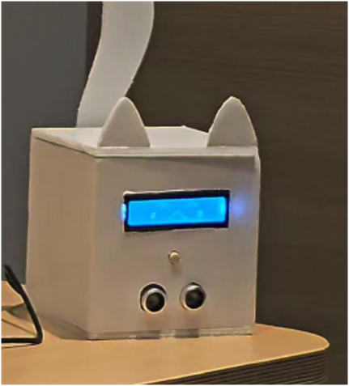
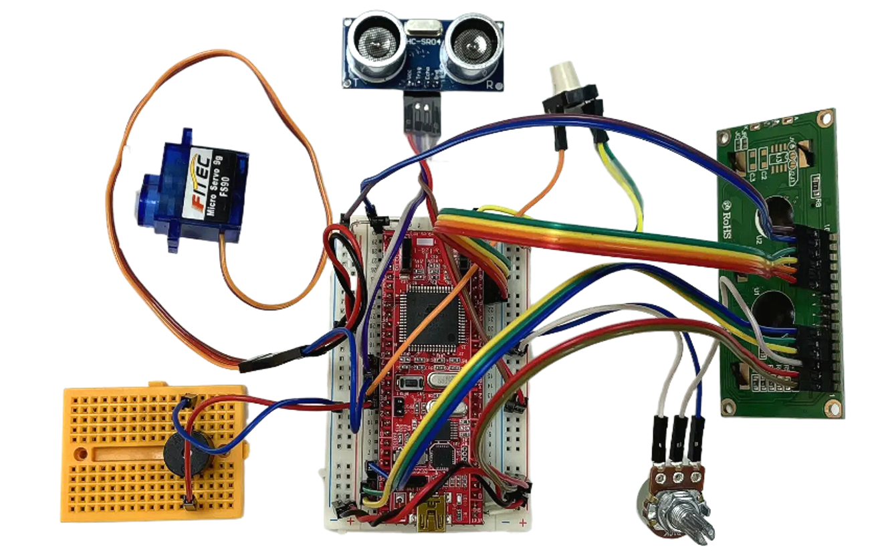
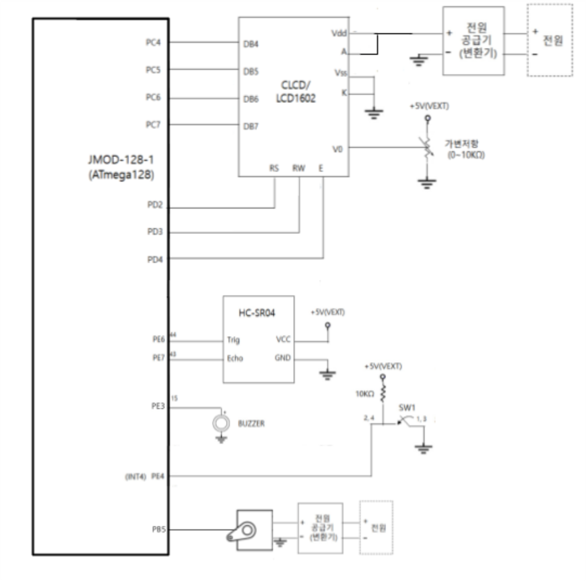
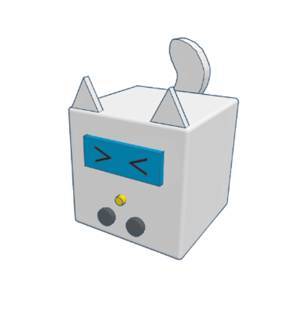

# AVR Care Companion Prototype

A three-person embedded-systems course project using an ATmega128A at 16 MHz. The initial goal was an interactive companion for older adults living alone, combining proximity interaction, inactivity monitoring, and medication reminders.

## Prototype and demonstration

Original course-prototype photograph. These recordings document the historical hardware demonstration; they are not a new verification of the archived source snapshot.

| Recording | Duration | Scenario |
| --- | --- | --- |
| [Proximity interaction and inactivity demo](docs/videos/proximity-and-inactivity.mp4) | 78 s | Proximity interaction and inactivity-monitoring demonstration |
| [Medication reminder demo](docs/videos/medication-reminder.mp4) | 37 s | Scheduled reminder and confirmation demonstration |
| [Early and repeated confirmation demo](docs/videos/medication-exceptions.mp4) | 24 s | Early/repeated button-confirmation scenarios |

Open each link to view or download the original MP4. Button confirmations simulate medication-taking events; actual ingestion is not sensed.

## Hardware connections

ATmega128A firmware uses a 16 MHz CPU clock. The table below records port assignments from the source, consistent with the supplied circuit diagram for the listed signals. MCU port names are not board connector numbers.

| MCU port | Peripheral signal |
| --- | --- |
| PE6 | HC-SR04 TRIG |
| PE7 | HC-SR04 ECHO |
| PB5 | Servo control signal |
| PE3 | Buzzer control |
| PE4 / INT4 | Medication confirmation button |
| PC4–PC7 | LCD DB4–DB7 |
| PD2 | LCD RS |
| PD3 | LCD R/W |
| PD4 | LCD E |

The diagram labels the board JMOD-128-1 and shows peripheral power connections. It is an original course reference, not a newly validated electrical schematic; it does not document the UART adapter wiring. Consult the actual module and board documentation before reproducing the hardware.

Original enclosure concept

Concept illustration from the course presentation, distinct from the physical prototype shown above.

## Implemented behavior

- Ultrasonic proximity sensing with servo-driven tail movement.
- Separate FSMs for proximity, inactivity, and medication-related behavior.
- Character LCD facial expressions with priority and temporary overlays.
- Timer-driven system time and incremental LCD updates.
- Medication reminder buzzer and confirmation button.
- UART status and alert messages.

## My contribution

Jaejun Lee designed the overall FSM architecture and implemented ultrasonic sensing, servo tail control, the LCD display code, and system integration. Teammates contributed button/medication-alarm/UART functionality and facial-expression patterns/layout. This was a team project; the complete source is not presented as individual authorship.

## Demonstration scope

Inactivity thresholds were shortened to 15, 30, and 45 seconds for demonstration; some UART messages retain the originally intended hour-based wording. Emergency notification is represented by UART text only. Button input represents medication confirmation; the prototype does not detect actual ingestion. No clinical validation was performed.

## Files and status

- `src/main.c`: archived course-project source, with encoding normalized to UTF-8.
- `docs/initial-idea.txt`: original planning notes in Korean.
- `docs/functional-notes.txt`: original functional notes in Korean.

The planning notes record design intent and may differ from the final source. The archived code has not been rebuilt or retested during this portfolio preparation. The repository includes historical wiring photos and a circuit diagram, but not a complete IDE project or build configuration. It is a course prototype archive, not a ready-to-deploy care system.

